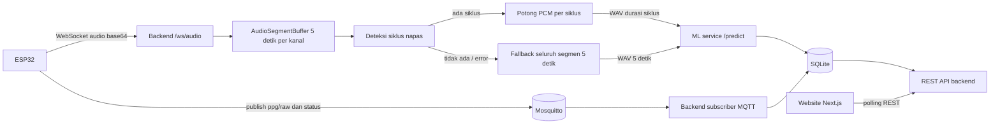

# Aliran Data Pneumacare

Dokumen ini menjelaskan perjalanan data dari perangkat ESP32 sampai tampil di website,
termasuk peran ML service dan deteksi siklus napas.

## Komponen

| Komponen | Alamat | Peran |
| --- | --- | --- |
| ESP32 | jaringan lokal | Mengirim audio lewat WebSocket, PPG/status lewat MQTT |
| Mosquitto | `localhost:1883` | Broker MQTT untuk PPG dan status perangkat |
| Backend Flask | `http://localhost:5000` | Ingestion, klasifikasi, tren, alert, REST API |
| ML service FastAPI | `http://localhost:8000` | `POST /predict` untuk klasifikasi suara paru |
| Website Next.js | `http://localhost:3000` | Polling REST API backend |
| SQLite | `backend/pneumacare.db` | Penyimpanan semua hasil |

## Diagram alir



## 1. Audio: ESP32 sampai hasil klasifikasi

### 1.1 Pengiriman chunk

ESP32 membuka WebSocket ke `ws://<backend>:5000/ws/audio` dan mengirim pesan JSON
berisi satu chunk audio:

```json
{
  "device_id": "pneumacare-a1b2",
  "channel_id": 1,
  "seq_no": 42,
  "timestamp_ms": 1700000000000,
  "chunk_duration_ms": 1000,
  "sample_rate": 16000,
  "bit_depth": 16,
  "pcm_base64": "..."
}
```

- `pcm_base64` adalah PCM **int16 little-endian**, mono.
- `seq_no` dipakai untuk mendeteksi chunk yang hilang; gap hanya dicatat di log.
- Jika `DEVICE_AUTH_TOKEN` diisi, backend mewajibkan header
  `Authorization: Bearer <token>`.

### 1.2 Penyusunan segmen 5 detik

`backend/ingestion/audio_segment_buffer.py` mengakumulasi chunk per
`(device_id, channel_id)` sampai mencapai 5.000 ms. Saat genap:

- satu `Segment` dikirim ke pipeline analisis;
- buffer kanal tersebut dikosongkan untuk segmen berikutnya.

Mekanisme ini **tumbling, bukan overlapping**: audio 0-5 detik, lalu 5-10 detik, dan
seterusnya. Tidak ada window 2,5-7,5 detik.

### 1.3 Deteksi siklus napas

Setelah segmen 5 detik terbentuk, `backend/analysis/cycle_segmenter.py` menjalankan
detektor `backend/analysis/resp_cycle.py` pada channel tersebut:

- STFT pada band 80-1000 Hz, smoothing, lalu pencarian boundary siklus dengan DTW.
- Hasilnya berupa daftar interval `(start_s, end_s)`; label inhale/exhale **tidak**
  ditentukan oleh detektor.
- Detektor membutuhkan `sample_rate > 2000 Hz` (firmware 16 kHz aman).

Untuk setiap siklus, backend memotong PCM tepat pada `start_s` sampai `end_s` dan
mengirim potongan itu ke ML service sebagai WAV. Tidak ada window 5 detik baru.

Jika tidak ada siklus, sample rate tidak didukung, atau detektor melempar error,
backend memakai **fallback**: seluruh segmen 5 detik diklasifikasikan seperti
mekanisme lama. Status fallback tetap dicatat.

### 1.4 Klasifikasi di ML service

`backend/inference/ml_service_client.py` mengubah PCM menjadi WAV di memori dan
mengirim multipart ke `POST /predict`. ML service melakukan resample ke 16 kHz dan
`fix_length` ke 5 detik:

- audio lebih dari 5 detik di-center-crop;
- audio kurang dari 2,5 detik di-tile, lalu sisa kekurangannya di-zero-pad;
- audio 2,5-5 detik di-zero-pad di ujung.

Karena durasi siklus dibatasi 1,25-5,5 detik, potongan yang dikirim tetap dapat
diproses model. Respons berisi indeks kelas (`0=normal`, `1=abnormal`), confidence,
dan probabilitas. Backend memetakan hasilnya ke `normal`/`abnormal`.

Jika ML service gagal, backend otomatis memakai `mock_inference` agar pipeline tidak
berhenti. Kolom `model_version` membedakan hasil model nyata (`ast_model_v1.0`) dari
mock (`mock_v3`).

### 1.5 Penyimpanan hasil

- `readings_classification` — satu baris per hasil klasifikasi. Jika satu segmen 5
  detik menghasilkan beberapa siklus, ada beberapa baris dengan `segment_start` dan
  `segment_end` sesuai boundary siklus.
- `respiratory_cycles` — satu baris per baris klasifikasi, berisi:
  - `analysis_start`/`analysis_end`: segmen 5 detik sumbernya;
  - `detection_status`: `detected`, `no_cycles`, `unsupported_sample_rate`, atau `error`;
  - `cycle_index`, `cycle_start_ms`, `cycle_end_ms`: boundary absolut (NULL untuk fallback);
  - `mean_dtw` dan `dtw_score`: skor kecocokan pola siklus. `dtw_score` siklus model
    bernilai NULL karena siklus itu menjadi acuan DTW, bukan diuji terhadap dirinya sendiri.

## 2. PPG, vital, dan status perangkat

ESP32 mem-publish MQTT:

- `pneumacare/{device_id}/ppg/raw` — batch sampel PPG (IR, opsional red).
- `pneumacare/{device_id}/status` — `online`/`offline`, opsional `battery_pct`.

Backend mengakumulasi PPG selama 15 detik, lalu:

1. memfilter band kardiak 1-2 Hz;
2. mengestimasi HR dan SpO2;
3. menyimpan `readings_vital` (RR selalu `NULL` karena sumber sinyalnya belum ada);
4. menjalankan alert engine hanya untuk nilai dengan confidence `good`.

Perubahan status perangkat dicatat di `device_status_log`; watchdog menandai device
`offline` jika tidak ada heartbeat melewati `DEVICE_OFFLINE_TIMEOUT_SECONDS` (30 detik).

## 3. Analisis tren dan alert

Setelah semua klasifikasi untuk satu segmen analisis disimpan:

- **Tren** (`backend/trend_analysis/`): query histori `readings_classification`,
  hitung frekuensi abnormal dalam rolling window 6 klasifikasi, moving average 3 titik,
  lalu regresi linear. Slope positif di atas ambang 0,05 per menit dianggap signifikan.
  Hasil disimpan di `trend_events`.
- **Alert** (`backend/alerting/`): evaluasi ambang per pasien (`thresholds`), tren
  signifikan yang persisten 3 kali, dan deduplikasi/cooldown 600 detik. Hasil disimpan
  di `alerts`.

Catatan: ketika satu segmen 5 detik menghasilkan beberapa siklus, ada beberapa baris
klasifikasi untuk segmen itu. Rolling window tren tetap dihitung per baris klasifikasi,
sehingga 6 event bisa mencakup rentang waktu yang lebih pendek daripada 30 detik.

## 4. Website

Website tidak menerima push dari backend. Semua data diambil lewat REST API dengan
polling:

| Halaman/data | Interval |
| --- | --- |
| Beranda pasien (summary, profil, alert) | 15 detik |
| Detail pasien di portal tenaga medis | 5 detik |
| Daftar pasien dan pusat notifikasi | 15 detik |
| Riwayat vital | 60 detik |
| Hasil klasifikasi terbaru | 15 detik |
| Riwayat klasifikasi | 5 menit |

Halaman `/demo/*` memakai data demo lokal, bukan API backend.

## 5. Tabel database

| Tabel | Isi |
| --- | --- |
| `users` | Akun pasien dan tenaga medis |
| `patients` | Profil pasien |
| `devices` | Perangkat dan pasangannya dengan pasien |
| `device_status_log` | Riwayat perubahan status online/offline |
| `device_pairing_codes` | Kode pairing perangkat |
| `readings_vital` | HR, SpO2, RR hasil estimasi PPG |
| `readings_classification` | Hasil klasifikasi suara paru |
| `respiratory_cycles` | Boundary dan status deteksi siklus napas |
| `trend_events` | Hasil analisis tren frekuensi abnormal |
| `alerts` | Alert yang dihasilkan alert engine |
| `thresholds` | Ambang klinis per pasien (default masih kosong) |
| `patient_action_plans` | Rencana tindakan dari tenaga medis |

## 6. Catatan penting

- Segmen 5 detik adalah **5 detik audio per channel**, bukan timer wall-clock. Jika
  chunk dari beberapa channel dikirim bergantian, satu channel bisa terisi lebih lama
  dari 5 detik wall-clock.
- Deteksi siklus pada segmen 5 detik bisa sering jatuh ke fallback karena detektor
  membutuhkan beberapa siklus yang jelas. Fallback bukan error.
- Detektor memakai DTW; tanpa `numba`, proses ini bisa memakan waktu beberapa detik per
  segmen dan menahan loop WebSocket.
- Model B (severity) belum tersedia; kolom severity selalu `NULL`.
- Checkpoint `best.ckpt` tidak di-commit. Tanpa checkpoint, ML service tetap boot tetapi
  `/predict` membalas 503, sehingga backend memakai mock.
- Backend tidak mem-publish alert ke MQTT; website membaca alert lewat REST.
